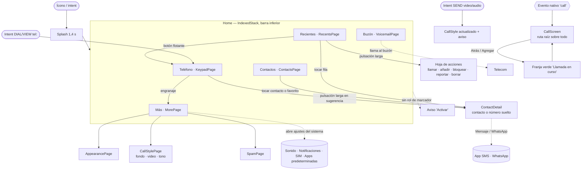
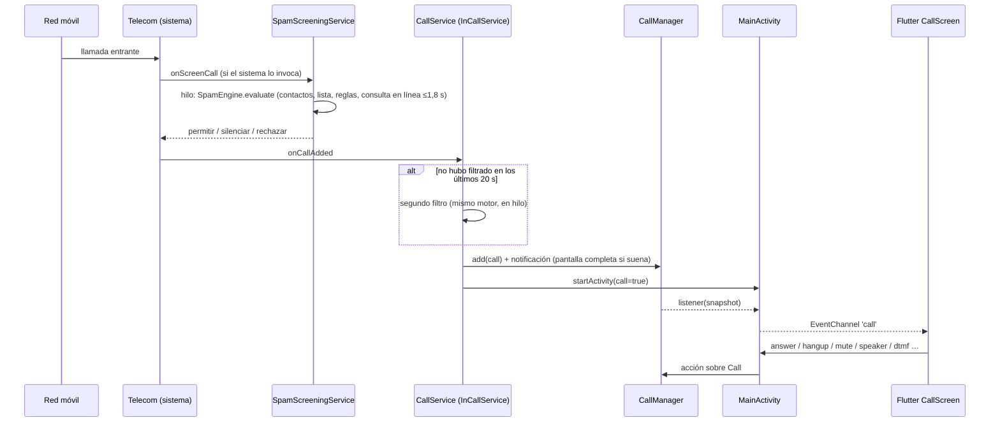

# NEXLIA — Fase 0: auditoría técnica

**Rama:** `audit/fase-0` (creada desde `docs/arquitectura-plataforma` @ `4f41302`, que es `main` @ `808f61e` + el documento de arquitectura)
**Fecha:** 12 de noviembre de 2026
**Alcance:** auditoría del estado real. No se modificó código de la app, el motor de llamadas, los flujos SMS ni `main`.
**Referencia:** `docs/ARQUITECTURA_NEXLIA.md`

---

## 0. Resumen ejecutivo

- **Compila y las pruebas pasan.** Primera ejecución de verificación en CI: análisis estático sin errores ni advertencias (35 avisos informativos), 12 pruebas Dart y las pruebas Kotlin pasan, APK debug compila.
- **El repositorio no es un proyecto Flutter compilable por sí mismo.** No contiene `pubspec.yaml`, `pubspec.lock` ni archivos Gradle: CI y `instalar.ps1` regeneran el proyecto con `flutter create` en cada compilación, usando la versión estable de Flutter del día y la última versión de `video_player`. **La compilación no es reproducible.**
- **Riesgo de compilación a corto plazo:** `package:flutter/cupertino.dart` está marcado como obsoleto desde Flutter 3.47 (aviso en los 8 archivos de interfaz y en 1 de prueba). Si una versión estable futura lo elimina, el siguiente push a `main` deja de compilar.
- **Riesgo funcional principal (sin verificar en dispositivo):** con doble SIM y "Preguntar siempre", una llamada saliente queda en estado `SELECT_PHONE_ACCOUNT` y NEXLIA no muestra el selector de SIM; la pantalla se queda en "Llamando…".
- **SMS/MMS:** no existe integración propia. NEXLIA no tiene el rol SMS ni permisos SMS; "Mensaje" abre la app de SMS del sistema.
- **Backend de spam:** sin evidencia de despliegue. Si se despliega tal cual, cualquiera con la clave (que viaja dentro de la app) puede marcar números como spam con identificadores de dispositivo inventados.
- **Contradicciones con la arquitectura:** hay que decidir 5 puntos antes de la Fase 1 (sección 10).

---

## 1. Inventario real de módulos y dependencias

### 1.1 Estructura del repositorio (`main` @ `808f61e`)

| Ruta | Líneas | Rol |
|---|---:|---|
| `lib/main.dart` | 349 | Arranque, tema, `Home` (5 pestañas), splash, avisos de rol y llamada minimizada, enrutado de eventos nativos |
| `lib/native.dart` | 252 | Puente `MethodChannel`/`EventChannel`, modelos `Contact`/`CallEntry`, `AppData` (estado global) |
| `lib/common.dart` | 498 | Tokens de color, `AppTheme`, `CallStyle`, formatos, widgets compartidos, diálogos, acciones (llamar/bloquear/reportar) |
| `lib/keypad_page.dart` | 478 | Marcador, búsqueda, sugerencias T9 |
| `lib/contacts_page.dart` | 529 | Lista de contactos con índice A–Z, favoritos, ficha de contacto/número |
| `lib/recents_page.dart` | 290 | Historial agrupado por día y número |
| `lib/call_screen.dart` | 585 | Pantalla de llamada, DTMF, respuesta por SMS, video/tono propio, foto desenfocada |
| `lib/more_page.dart` | 545 | Configuración, Apariencia, Pantalla de llamada, Buzón de voz |
| `lib/spam_page.dart` | 308 | Ajustes del bloqueador, listas, registro, servidor |
| `android/kotlin/MainActivity.kt` | 404 | 40 métodos nativos, roles, permisos, contactos, registro de llamadas, selector de medios, compartir |
| `android/kotlin/CallService.kt` | 142 | `InCallService`: alta/baja de llamadas, segundo filtro de spam, notificaciones |
| `android/kotlin/CallManager.kt` | 122 | Estado compartido de llamadas y acciones (contestar, colgar, espera, unir, audio) |
| `android/kotlin/Spam.kt` | 243 | `SpamStore`, `SpamEngine` (reglas), `SpamScreeningService` |
| `android/AndroidManifest.xml` | 86 | Permisos, filtros DIAL/VIEW/SEND, servicios de llamada y filtrado |
| `servidor/spam_api.php`, `schema.sql` | 75 + 18 | API de reportes de spam (PHP + MySQL) |
| `.github/workflows/apk.yml` | 117 | Compila y publica una release firmada en cada push a `main` |
| `instalar.ps1` / `.bat` | 64 + 3 | Arma el proyecto en Windows (`C:\proyectos\nexlia`) |
| `assets/`, `android/res/`, `icono/` | — | Icono (5 densidades) y splash |

Código propio: ~3 830 líneas Dart, ~910 Kotlin, ~95 PHP/SQL.

### 1.2 Dependencias efectivas (resueltas en CI, 12-nov-2026)

| Componente | Versión | Cómo se fija |
|---|---|---|
| Flutter / Dart | 3.50.0 / 3.14.0 | **No fijada** (`channel: stable`) |
| `video_player` | 2.14.1 (`video_player_android` 2.12.2) | **No fijada** (`flutter pub add video_player`) |
| `cupertino_icons` | 1.0.9 | Plantilla de `flutter create` |
| JDK | Temurin 17.0.21 | Fijado a la versión mayor 17 |
| Gradle | 9.5.0 | Lo genera `flutter create` |
| compileSdk / targetSdk / minSdk | `flutter.compileSdkVersion` / **36** / **29** | minSdk forzado por `sed`; el resto, la plantilla |
| Acciones de GitHub | `checkout@v4`, `setup-java@v4`, `flutter-action@v2`, `action-gh-release@v2` | Versión mayor |
| PHP (CI) / local | 8.5.4 / 8.3.6 | — |

No hay `pubspec.lock` en el repositorio: cada compilación puede resolver versiones distintas.

### 1.3 Puente nativo (único canal)

- `MethodChannel('nexlia/phone')`: **40 métodos**, agrupados así:
  - **Rol y permisos:** `isDefaultDialer`, `requestDefaultDialer`, `requestPermissions`.
  - **Contactos y registro:** `getContacts`, `getContactPhoto`, `addContact`, `deleteContact`, `setStarred`, `getCallLog`, `deleteCallLog`.
  - **Llamadas:** `placeCall`, `getCallState`, `answer`, `hangup`, `toggleHold`, `swapCalls`, `mergeCalls`, `setMuted`, `setSpeaker`, `setBluetooth`, `dtmf`, `rejectWithMessage`, `callVoicemail`, `takeDialNumber`.
  - **Integraciones externas:** `sendSms`, `openWhatsApp`, `openSettings`.
  - **Medios y timbre:** `pickMedia`, `removeMedia`, `ringerNormal`, `silenceRinger`.
  - **Preferencias:** `getPref`, `setPref`, `getVersion`.
  - **Spam:** `getSpamData`, `setSpamSettings`, `setBlocked`, `clearSpamLog`, `reportSpam`, `testServer`.
- `EventChannel('nexlia/phone/events')`: eventos `call` (estado completo), `dial` (número desde otra app) y `shared` (video/audio compartido).
- Persistencia: `SharedPreferences` nativas `ui` (tema, fondo, tono, video) y `spam` (ajustes, lista negra, registro de 200 entradas, ID de dispositivo); archivos de medios copiados en `filesDir`.

### 1.4 Permisos finales del APK (manifiesto fusionado en CI)

`CALL_PHONE`, `READ_CALL_LOG`, `WRITE_CALL_LOG`, `READ_CONTACTS`, `WRITE_CONTACTS`, `READ_PHONE_STATE`, `INTERNET`, `POST_NOTIFICATIONS`, `USE_FULL_SCREEN_INTENT`, `VIBRATE`; añadidos por plugins/AndroidX: `ACCESS_NETWORK_STATE`, `WAKE_LOCK`, `com.nexlia.phone.DYNAMIC_RECEIVER_NOT_EXPORTED_PERMISSION`. **Ningún permiso SMS/MMS.**

Roles: `ROLE_DIALER` (solicitado). `CallScreeningService` declarado; no se solicita `ROLE_CALL_SCREENING` por separado.

---

## 2. Diagrama de navegación actual

Observaciones:
- Las cinco pestañas viven en un `IndexedStack`: todas se construyen al arrancar y permanecen en memoria.
- La navegación objetivo del documento (Inicio · Llamadas · Mensajes · Contactos · Perfil/Más) **no coincide** con la actual (Teléfono · Contactos · Recientes · Buzón · Más). Ver sección 10.

---

## 3. Auditoría del motor telefónico Kotlin

### 3.1 Flujo de una llamada entrante

### 3.2 Hallazgos

| # | Sev. | Hallazgo | Evidencia |
|---|---|---|---|
| K1 | **Alta*** | `STATE_SELECT_PHONE_ACCOUNT` se muestra como "dialing" y no hay selector ni llamada a `phoneAccountSelected()`. Con doble SIM en "Preguntar siempre", la salida queda bloqueada. Como app de marcador, NEXLIA es quien debe mostrar el selector. | `CallManager.kt:57`; [AOSP: Phone account suggestion](https://source.android.com/docs/core/connect/phone-account-suggestion) |
| K2 | Media | Un único `pending: MethodChannel.Result` compartido por rol, permisos y selector de medios. Dos solicitudes simultáneas (p. ej. permisos al arrancar + tocar "Activar") dejan un `Future` de Dart colgado para siempre. | `MainActivity.kt:29, 117, 131, 235` |
| K3 | Media | `SpamEngine.lastReasons` y `screenedAt` son `HashMap` escritos desde hilos de fondo y leídos en el principal: condición de carrera. | `Spam.kt:70-73`, `CallService.kt:54-59`, `Spam.kt:223-230` |
| K4 | Media | `CallManager.snapshot()` consulta `ContentResolver` (nombre de contacto) en el hilo principal en cada cambio de estado; la caché `names` nunca se invalida (contactos nuevos o renombrados siguen saliendo como antes durante la vida del proceso). | `CallManager.kt:52-54` |
| K5 | Baja | `merge()` no comprueba `CAPABILITY_MERGE_CONFERENCE`; el botón "Unir" puede no hacer nada. | `CallManager.kt:107-111` |
| K6 | Baja | `current` puede devolver una llamada hija de una conferencia; `count` sí filtra por `parent == null`. | `CallManager.kt:24-25, 72` |
| K7 | Baja | El segundo filtro de `CallService` retrasa la pantalla hasta 1,8 s (consulta en línea) mientras el sistema ya está timbrando. | `CallService.kt:51-70` |
| K8 | Baja | `importMedia` copia archivos sin límite de tamaño, desde una actividad exportada que acepta `SEND video/*, audio/*`. | `MainActivity.kt:271-300` |
| K9 | Baja | `handleShare` se vuelve a procesar si la actividad se recrea con el mismo intent. | `MainActivity.kt:48, 78` |
| K10 | Info | `callAudioState` está obsoleto desde API 34 (sigue funcionando). `getPackageInfo(String,int)` obsoleto desde API 33. | — |
| K11 | Info | No se implementa `ACTION_SHOW_MISSED_CALLS_NOTIFICATION`; se asume que Telecom muestra las perdidas. **Sin verificar en dispositivo.** | — |

\* Severidad alta condicionada a usar dos SIM con "Preguntar siempre".

**No verificado en dispositivo:** si el sistema invoca `SpamScreeningService` en Xiaomi HyperOS y Samsung One UI siendo NEXLIA el marcador; el segundo filtro existe precisamente por esa duda.

---

## 4. Estado de llamadas y doble SIM

| Capacidad | Estado |
|---|---|
| Llamar, contestar, rechazar, colgar | Implementado (`TelecomManager.placeCall`, `Call.answer/reject/disconnect`) |
| Espera, cambiar, unir | Implementado; unir sin comprobar capacidad (K5) |
| Silencio, altavoz, Bluetooth | Implementado (`setMuted`, `setAudioRoute`) |
| DTMF | Implementado (tono de 160 ms) |
| Rechazar con SMS | Implementado vía `Call.reject(true, texto)`, que envía Telecom; **sin verificar en dispositivo** |
| Buzón de voz | Llama a `voicemail:` con la cuenta por defecto |
| Llamadas de emergencia | Delegadas a Telecom; **sin prueba** |
| **Selección de SIM al llamar** | **No implementado.** `placeCall` sin `EXTRA_PHONE_ACCOUNT_HANDLE` y sin manejo de `SELECT_PHONE_ACCOUNT` (K1) |
| **Indicador de SIM** | **No implementado.** El registro no lee `PHONE_ACCOUNT_ID`; ni Recientes ni la llamada muestran la SIM |
| SIM predeterminada / cambio | Depende del ajuste del sistema; sin pruebas |
| Pruebas en doble SIM | **Ninguna** (se desconoce si los equipos de prueba tienen dos SIM) |

`READ_PHONE_STATE` ya está concedido, lo que permite listar `getCallCapablePhoneAccounts()` sin pedir permisos nuevos.

---

## 5. Estado actual de SMS/MMS

| Aspecto | Estado real |
|---|---|
| Rol SMS predeterminado | No solicitado, no declarado |
| Permisos `SEND_SMS`, `RECEIVE_SMS`, `READ_SMS`, `RECEIVE_MMS`, `RECEIVE_WAP_PUSH` | Ausentes |
| Componentes exigidos para el rol (receptor `SMS_DELIVER`, receptor `WAP_PUSH_DELIVER`, servicio `RESPOND_VIA_MESSAGE`, actividad `SENDTO smsto:`) | Ausentes |
| Botón "Mensaje" (ficha) | Abre la app de SMS del sistema (`ACTION_SENDTO`) |
| "Responder con mensaje" (llamada entrante) | Lo envía Telecom mediante la app de SMS predeterminada del sistema |
| Bandeja, hilos, MMS | No existen |

**Dependencia crítica para la Fase 2:** si NEXLIA pasa a ser la app de SMS predeterminada, Telecom enviará "Responder con mensaje" a NEXLIA (`RESPOND_VIA_MESSAGE`). Sin ese servicio implementado, la función que hoy funciona dejaría de hacerlo.

---

## 6. Auditoría del backend PHP/MySQL

**Estado de despliegue:** sin evidencia. La app trae la consulta en línea desactivada y la dirección vacía. *Pendiente confirmar con el propietario.*

| # | Sev.* | Hallazgo | Evidencia |
|---|---|---|---|
| B1 | Alta | Una sola clave compartida, guardada en cada teléfono: quien la extraiga puede consultar y reportar. | `spam_api.php:9, 21` |
| B2 | Alta | `dispositivo` lo elige el cliente: un atacante puede inventar identificadores y marcar cualquier número como spam (envenenamiento de reputación). Contradice §7 Antispam. | `spam_api.php:55-62` |
| B3 | Media | `consultar` y `estado` reciben la clave por URL, que queda en los registros del servidor. **Reproducido** con `php -S`: `GET /spam_api.php?accion=estado&clave=x` aparece en el log. | prueba local |
| B4 | Media | Sin límite de frecuencia, sin caducidad de reportes, sin mecanismo de apelación. | — |
| B5 | Media | Credenciales de base de datos como constantes en el propio archivo: riesgo de subir secretos al repositorio al editarlo. | `spam_api.php:5-9` |
| B6 | Media | Privacidad: cada número desconocido que llama se envía al servidor si la consulta está activa. | `Spam.kt:142-147` |
| B7 | Baja | `VALUES()` en `ON DUPLICATE KEY UPDATE` está obsoleto desde MySQL 8.0.20. | `spam_api.php:67` |
| B8 | Baja | Sin migraciones versionadas; un solo `schema.sql`. Sin pruebas con base de datos. | — |

\* Severidad si se despliega.

Pruebas realizadas: `php -l` sin errores (PHP 8.3.6 local, 8.5.4 en CI); prueba de humo sin base de datos: clave incorrecta → 403; clave correcta sin base → 500 "sin conexion a la base de datos" (GET y POST). **No se probaron las rutas con MySQL** (no hay servidor de base de datos en el entorno).

---

## 7. Pruebas y compilación

### 7.1 Añadido en esta rama (sin tocar código de la app)

- `test/numeros_test.dart`, `test/formatos_test.dart`: pruebas de caracterización de funciones puras (`digits`, `sameNumber`, `CallEntry.missed`, `initials`, `formatDuration`, `formatTime`, `callKind`). Dos casos documentan **limitaciones actuales**, no comportamiento deseado.
- `test/marcador_test.dart`: prueba de humo del marcador (teclas y borrar).
- `android/test/SpamEngineTest.kt`: normalización de números y detección de internacionales (JVM, sin dispositivo).
- `.github/workflows/verificacion.yml`: en ramas distintas de `main` y en PR; arma el proyecto igual que `apk.yml`, sin firma ni publicación.

### 7.2 Resultado literal — ejecución [43268320236](https://github.com/SKYELR9510/NEXLIA/actions/runs/43268320236), commit `61a2987`

| Paso | Resultado |
|---|---|
| Entorno | Flutter 3.50.0 stable · Dart 3.14.0 · OpenJDK 17.0.21 · Gradle 9.5.0 · PHP 8.5.4 |
| `dart format --set-exit-if-changed lib test` (informativo) | 11 de 12 archivos cambiarían: el código no sigue el formato estándar |
| `flutter analyze --no-fatal-infos --no-fatal-warnings` | **35 avisos informativos, 0 advertencias, 0 errores**: 9 × `flutter/cupertino.dart` obsoleto, 10 × `withOpacity`, 6 × `minSize`, 8 × guiones bajos innecesarios, 1 import innecesario, 1 sugerencia `?` |
| `flutter test` | **12 pruebas pasan** |
| `flutter build apk --debug` | Compila |
| `./gradlew :app:testDebugUnitTest` | Compila y ejecuta `SpamEngineTest` sin fallos |
| Manifiesto fusionado | minSdk 29, targetSdk 36; permisos de la sección 1.4 |
| `php -l servidor/*.php` | Sin errores |

### 7.3 Lo que **no** se ejecutó

- Ninguna prueba en dispositivo (llamadas reales, doble SIM, filtrado de spam, pantalla bloqueada, Bluetooth, buzón).
- Compilación release en esta rama (`apk.yml` solo corre en `main`; la última release, v1.0.13, compiló bien).
- Pruebas instrumentadas de Android, pruebas del backend con MySQL, pruebas de accesibilidad.
- Ninguna herramienta de Flutter ni del SDK de Android en el entorno local: todo lo anterior se ejecutó en GitHub Actions.

### 7.4 Comandos reproducibles

- **CI:** push a cualquier rama distinta de `main`; se ejecuta `Verificación`.
- **Local (Windows):** `instalar.bat`, después copiar `test\*` a `C:\proyectos\nexlia\test\` y ejecutar `flutter analyze`, `flutter test` y `flutter build apk --debug`. **Advertencia:** un APK compilado en la PC no está firmado con la clave de las releases y no se instala encima de ellas.

---

## 8. Riesgos y posibles regresiones

| # | Sev. | Riesgo | Mitigación propuesta |
|---|---|---|---|
| R1 | Alta | Compilación no reproducible: Flutter y `video_player` sin fijar, sin `pubspec.lock`, proyecto regenerado en cada build | Fijar `flutter-version`; versionar `pubspec.yaml`/`pubspec.lock`/Gradle (decisión D1) |
| R2 | Alta | `flutter/cupertino.dart` obsoleto desde 3.47: una versión estable futura puede romper el build de `main` | Fijar Flutter ya; evaluar `cupertino_ui` como tarea separada |
| R3 | Alta* | Doble SIM con "Preguntar siempre": salida bloqueada (K1) | PR específico con prueba en equipo de dos SIM |
| R4 | Media | Cada push a `main` publica una release sin pasar pruebas | Hacer que `apk.yml` dependa de la verificación |
| R5 | Media | Tono o video propio por el canal multimedia: puede sonar con "No molestar" en modo prioridad y durante una llamada en espera; si `play()` falla después de `silenceRinger()`, la llamada entra muda | Reproducir por el canal de timbre o respetar el filtro de interrupciones; no silenciar hasta confirmar que reproduce |
| R6 | Media | `Future` de Dart colgados por el `pending` compartido (K2) | Un `Result` por código de solicitud |
| R7 | Media | Rendimiento con agendas grandes: se recargan todos los contactos y 300 llamadas al volver a la app; `contactFor` recorre la lista entera por cada fila; caché de fotos sin límite | Índice por número normalizado; carga incremental |
| R8 | Media | Permisos pedidos todos al arrancar, incluidos `WRITE_CALL_LOG`/`WRITE_CONTACTS`; contradice "solicitar en contexto" | Pedir por función (Fase 1) |
| R9 | Media | Backend: envenenamiento de reputación, clave en URL (B1–B3) | Ver sección 6 antes de desplegar |
| R10 | Baja | Condiciones de carrera en el motor de spam (K3) | `ConcurrentHashMap` |
| R11 | Baja | Normalización: `51987654321` sin "+" no se convierte a nacional (las reglas de prefijo fallan); `sameNumber` confunde países con los mismos 9 dígitos finales | Documentado en pruebas; corregir con normalización E.164 |
| R12 | Baja | `instalar.ps1` y `LEEME.md` desactualizados (LEEME menciona pestañas Spam y Favoritos que ya no existen; el script solo contempla Gradle `.kts`) | Actualizar al convertir el repo en proyecto completo |
| R13 | Baja | Código muerto: `LargeTitle`, `Glass` en `common.dart` | Eliminar en la Fase 1 |
| R14 | Baja | `allowBackup` por defecto: la copia de Google incluye ajustes de spam (con la clave del servidor) | Reglas de respaldo |
| R15 | Baja | `USE_FULL_SCREEN_INTENT`: en Android 14+ fuera de Play puede requerir concesión; no se comprueba `canUseFullScreenIntent()` | Comprobar y avisar |

---

## 9. Plan de integración con archivos concretos

Orden propuesto. Cada punto es una rama corta con su PR; ninguno se fusiona sin revisión.

### P0 — Estabilidad de compilación (antes de la Fase 1)

1. **`chore/build-reproducible`**
   - `.github/workflows/apk.yml`, `.github/workflows/verificacion.yml`: `flutter-version: 3.50.0`.
   - `video_player:^2.14.1` en ambos flujos y en `instalar.ps1`.
   - `apk.yml`: no publicar si falla la verificación.
   - Si se aprueba D1, versionar `pubspec.yaml`, `pubspec.lock`, `android/app/build.gradle.kts`, `android/settings.gradle.kts`, `android/build.gradle.kts` y convertir `instalar.ps1` en "clonar y ejecutar".
2. **`fix/seleccion-sim`** (toca el motor; requiere análisis de impacto y prueba con dos SIM)
   - `android/kotlin/CallManager.kt`: exponer las cuentas disponibles cuando el estado es `SELECT_PHONE_ACCOUNT`; nuevo `selectAccount(id)` que llame a `phoneAccountSelected`.
   - `android/kotlin/MainActivity.kt`: método `selectPhoneAccount`; `PHONE_ACCOUNT_ID` en `callLog()`.
   - `lib/native.dart`, `lib/call_screen.dart`: hoja de selección de SIM; etiqueta de SIM.
   - `lib/recents_page.dart`: indicador de SIM por fila.
3. **`fix/resultados-nativos`**: `android/kotlin/MainActivity.kt` (un `Result` por solicitud), `android/kotlin/Spam.kt` (`ConcurrentHashMap`).

### Fase 1 — Sistema visual y navegación (sin tocar el motor)

| Paso | Archivos |
|---|---|
| 1. Tokens de marca (azul marino, azul eléctrico, cian, neutros) y temas claro/oscuro/sistema | Nuevo `lib/core/design/tokens.dart`; nuevo `lib/core/design/theme.dart` (mover `AppTheme` desde `lib/common.dart`) |
| 2. Quitar morados `0xFF5E5CE6` y `0xFF7D3CFF`; sustituir los 81 colores literales por tokens, archivo por archivo | `lib/more_page.dart` (20), `lib/common.dart` (18), `lib/call_screen.dart` (17), `lib/main.dart` (9), `lib/spam_page.dart` (7), `lib/contacts_page.dart` (5), `lib/keypad_page.dart` (3), `lib/recents_page.dart` (2) |
| 3. Componentes compartidos, sin cambiar su comportamiento; eliminar `LargeTitle` y `Glass` | Nuevo `lib/core/design/widgets/` (`avatar.dart`, `pill.dart`, `screen_title.dart`, `search_pill.dart`, `dialogs.dart`) desde `lib/common.dart` |
| 4. Navegación centralizada (definición de pestañas en un solo lugar); mantener las pestañas actuales hasta decidir D2 | Nuevo `lib/app/navigation.dart`; `lib/main.dart` |
| 5. Corregir avisos de obsolescencia (`withOpacity`→`withValues`, `minSize`→`minimumSize`) y aplicar `dart format` | Todos los `lib/*.dart` |
| 6. Pruebas: widget por pantalla, tema claro/oscuro, tamaño de texto grande | `test/` |

Fuera de la Fase 1 pero relacionado: capa de repositorios (`lib/data/phone_repository.dart` sobre `Native`) a medida que se toque cada pantalla, en lugar de un cambio masivo.

---

## 10. Contradicciones con `ARQUITECTURA_NEXLIA.md` (regla 13)

| # | Documento | Código real | Propuesta |
|---|---|---|---|
| D1 | "Compila en el entorno documentado" | El repo no contiene el proyecto Flutter; se regenera en cada build | Decidir si se versiona el proyecto completo (recomendado) |
| D2 | Navegación Inicio · Llamadas · Mensajes · Contactos · Perfil | Teléfono · Contactos · Recientes · Buzón · Más; Mensajes no existe | No mostrar "Mensajes" hasta la Fase 2/3 ("toda función visible implementada"); validar con prototipo |
| D3 | La interfaz no accede a APIs nativas desde widgets | Los widgets llaman a `Native.*` directamente | Migración gradual a repositorios |
| D4 | Prohibido morado como color de marca | Dos iconos morados en Configuración | Corregir en la Fase 1, paso 2 |
| D5 | Permisos en contexto | Todos al arrancar | Incluir en la Fase 1 o en un PR propio (toca permisos: requiere análisis) |
| D6 | Encabezado: "Rama de trabajo: `docs/arquitectura-plataforma`" | §10 dice que esa rama no es de desarrollo | Corregir el encabezado del documento |

---

## 11. Lista de tareas pendientes

**Decisiones del propietario**
- [ ] D1: versionar el proyecto Flutter completo en el repo.
- [ ] D2: navegación objetivo y cuándo aparece "Mensajes".
- [ ] Confirmar si el backend de spam está desplegado y dónde.
- [ ] Confirmar qué equipos de prueba tienen dos SIM y su configuración ("Preguntar siempre" o SIM fija).

**Pruebas manuales en dispositivo (Xiaomi HyperOS y Samsung)**
- [ ] Llamada saliente con una SIM y con dos SIM ("Preguntar siempre").
- [ ] Llamada entrante con pantalla bloqueada; contestar y rechazar desde la notificación.
- [ ] Bloqueo: número desconocido con "Rechazar"; comprobar "Llamadas filtradas" (¿se invoca `SpamScreeningService` o actúa el segundo filtro?).
- [ ] Llamada en espera + segunda entrante con tono/video propio (R5).
- [ ] "No molestar" activo con tono propio (R5).
- [ ] "Responder con mensaje" envía el SMS.
- [ ] Notificación de llamada perdida (K11).
- [ ] Buzón de voz, Bluetooth, unir llamadas.

**P0**
- [ ] `chore/build-reproducible` (R1, R2, R4).
- [ ] `fix/seleccion-sim` (K1, R3).
- [ ] `fix/resultados-nativos` (K2, K3).

**Fase 1**
- [ ] Pasos 1–6 de la sección 9.
- [ ] Actualizar `LEEME.md` e `instalar.ps1` (R12).

**Backend (antes de desplegar)**
- [ ] Clave por encabezado y solo POST; credenciales fuera del webroot (B3, B5).
- [ ] Registro de dispositivos y límites de frecuencia; caducidad y apelación de reportes (B1, B2, B4).
- [ ] Sustituir `VALUES()`; carpeta de migraciones; pruebas con MySQL (B7, B8).
- [ ] Aviso de privacidad sobre la consulta en línea (B6).

**Fase 2 (preparación)**
- [ ] Verificar políticas vigentes de Google Play para el rol SMS.
- [ ] Diseñar `HeadlessSmsSendService` antes de pedir el rol SMS, para no romper "Responder con mensaje".

---

## 12. Reporte (formato §12 del documento)

- **Objetivo:** Fase 0, auditoría técnica reproducible.
- **Estado previo verificado:** `main` @ `808f61e`; release v1.0.13; documento en `docs/arquitectura-plataforma` @ `4f41302`.
- **Archivos añadidos (solo esta rama):** `docs/AUDITORIA_FASE0.md`, `.github/workflows/verificacion.yml`, `test/numeros_test.dart`, `test/formatos_test.dart`, `test/marcador_test.dart`, `android/test/SpamEngineTest.kt`. **Ningún archivo existente modificado.**
- **Decisiones técnicas:**
  - Las pruebas son de caracterización: fijan el comportamiento actual, no el deseado.
  - La verificación no usa los secretos de firma ni publica.
  - El formato se reporta como aviso, sin bloquear.
- **Pruebas ejecutadas:** sección 7.2.
- **Riesgos o limitaciones:** secciones 3, 6 y 8; nada se probó en dispositivo.
- **Pasos manuales pendientes:** sección 11.
- **Rama:** `audit/fase-0`; sin fusionar.
